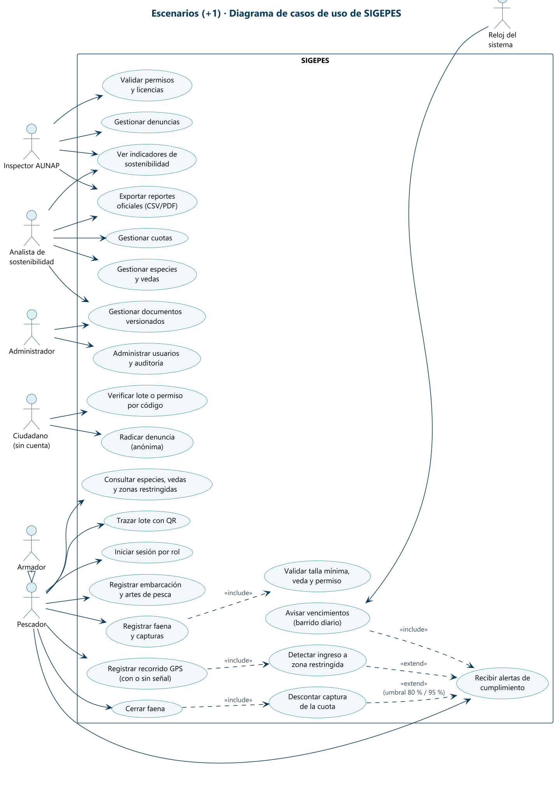
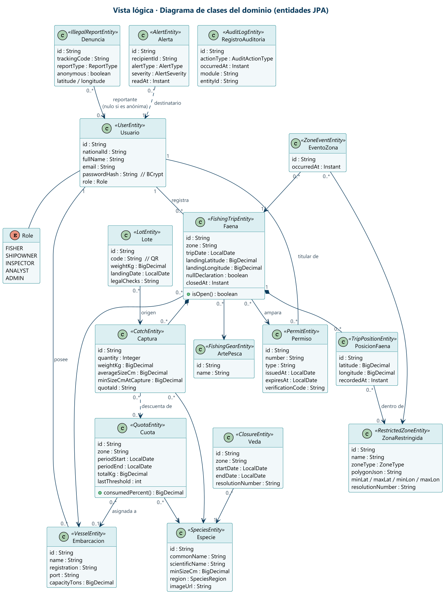
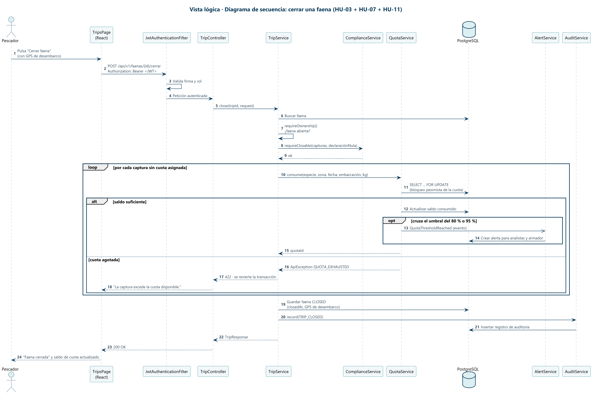
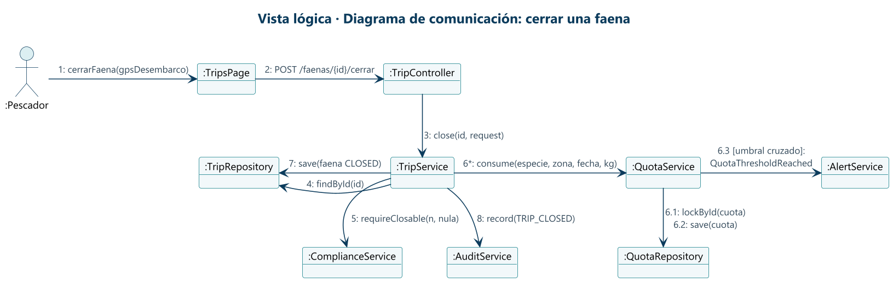
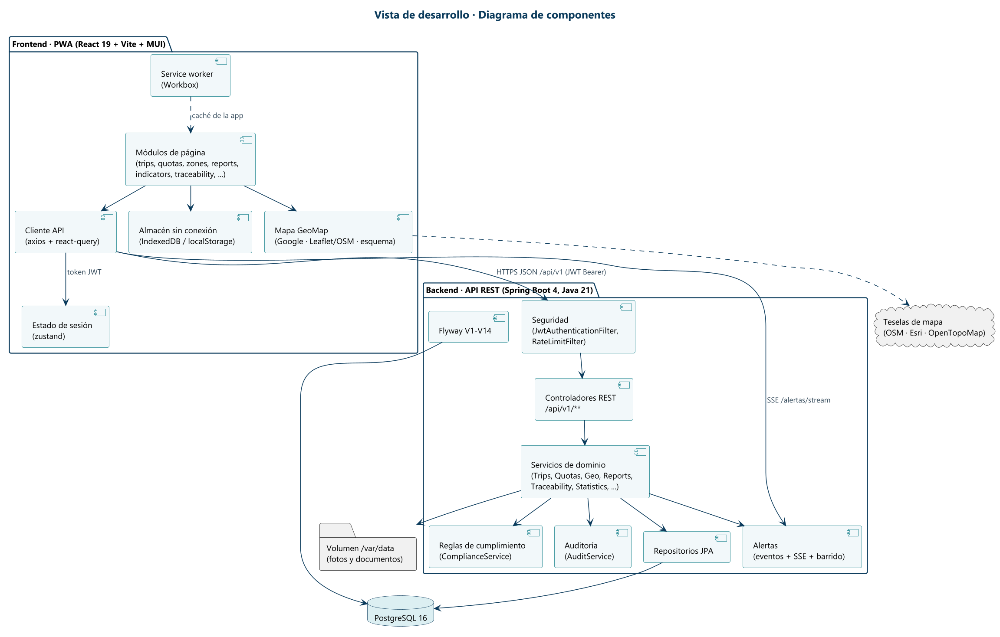
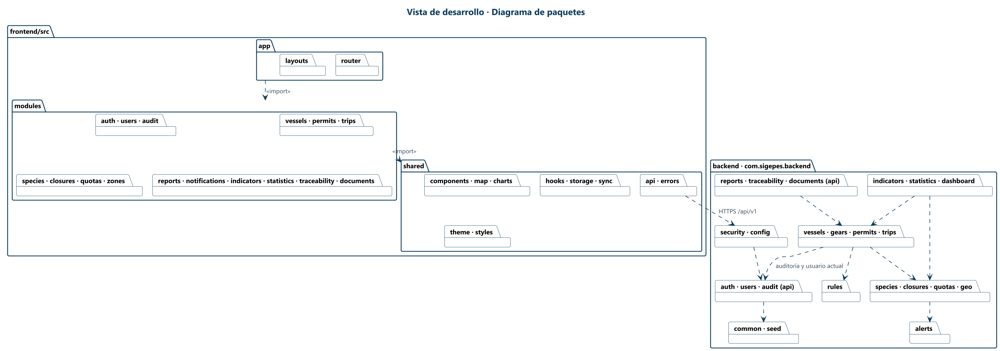
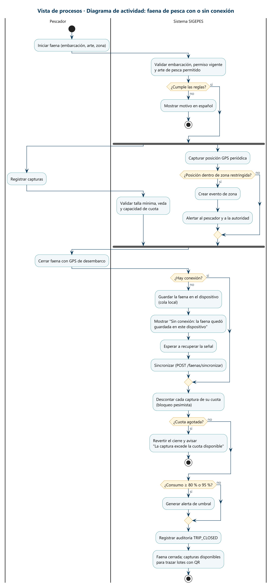
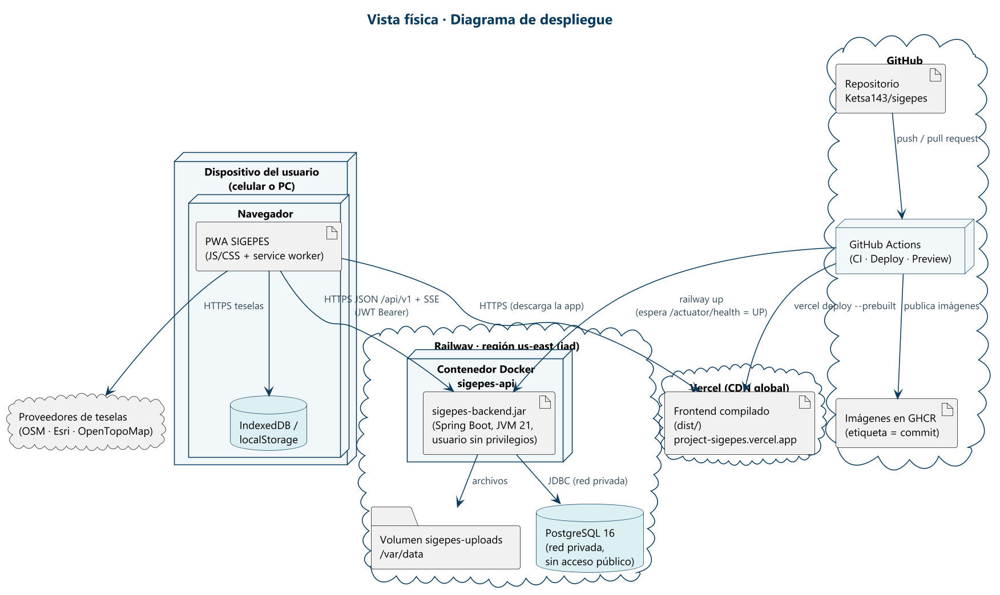

# Modelo de arquitectura 4+1 de SIGEPES

Los diagramas reflejan el código del repositorio (rama `main`, Sprint 2). Cada uno tiene su fuente
PlantUML (`.puml`) y la imagen generada en [`img/`](img).

Para regenerar las imágenes (Java 21 y el JAR de PlantUML, sin Graphviz):

```bash
java -jar plantuml.jar -charset UTF-8 -tpng -o img docs/arquitectura/0*.puml
```

| Vista | Para quién | Diagramas |
|---|---|---|
| **Lógica** | Analistas y desarrolladores: qué hace el sistema | [Clases](#clases) · [Secuencia](#secuencia) · [Comunicación](#comunicacion) |
| **Desarrollo** | Desarrolladores: cómo está organizado el código | [Componentes](#componentes) · [Paquetes](#paquetes) |
| **Procesos** | Integradores: concurrencia, sin conexión, flujo en ejecución | [Actividad](#actividad) |
| **Física** | Operación: dónde corre cada pieza | [Despliegue](#despliegue) |
| **Escenarios (+1)** | Todos: casos de uso que unen las cuatro vistas | [Casos de uso](#casos-de-uso) |

Las cuatro vistas se cruzan en el mismo escenario, **cerrar una faena** (HU-03, HU-07, HU-11):
- el caso de uso lo describe;
- los diagramas de secuencia y de comunicación muestran los objetos que lo resuelven;
- el de actividad muestra el flujo con y sin conexión;
- los de componentes y despliegue muestran dónde se ejecuta cada paso.

## Escenarios (+1)

### Casos de uso
Seis actores humanos y el reloj del sistema. El armador hereda los casos del pescador. Cerrar
faena *incluye* descontar la cuota, y el descuento *extiende* las alertas al cruzar el 80 % o el 95 %.



## Vista lógica

### Clases
Entidades JPA del dominio. La faena compone sus capturas y posiciones GPS; cada captura apunta a
la cuota de la que se descontó. La denuncia anónima no guarda reportante (lo impone un `CHECK` en la
base de datos).



### Secuencia
Cierre de faena de extremo a extremo:
- JWT;
- reglas de cumplimiento;
- descuento de cuota con bloqueo pesimista (`SELECT … FOR UPDATE`);
- evento de umbral que genera la alerta;
- auditoría.

Si una captura excede la cuota, la API responde 422 y se revierte toda la transacción.



### Comunicación
Los mismos mensajes, numerados sobre los enlaces entre objetos (`6*` = se repite por captura).



## Vista de desarrollo

### Componentes
PWA en React (con almacén sin conexión, service worker y mapa con tres niveles de respaldo) que habla con la API de Spring Boot por HTTPS/JSON y SSE.



### Paquetes
El frontend se organiza en `app → modules → shared`. El backend se organiza por módulo de dominio,
y todas las reglas de negocio pasan por `rules` (ComplianceService).



## Vista de procesos

### Actividad
Faena completa con dos hilos paralelos (registro de capturas y captura de GPS con detección de zona),
el camino sin conexión (cola local y sincronización) y el descuento de la cuota al cerrar.



## Vista física

### Despliegue
- **Navegador:** la PWA, con su almacenamiento local.
- **Vercel:** sirve el frontend compilado desde su CDN.
- **Railway:** corre el contenedor de la API, el volumen de archivos y PostgreSQL, que solo es accesible por la red privada.
- **GitHub Actions:** solo despliega lo que pasó el CI.


